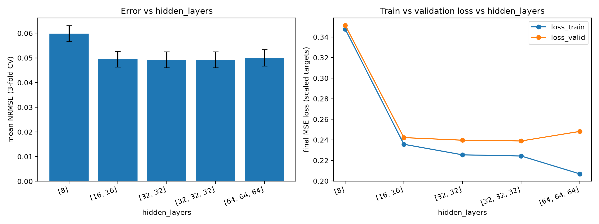
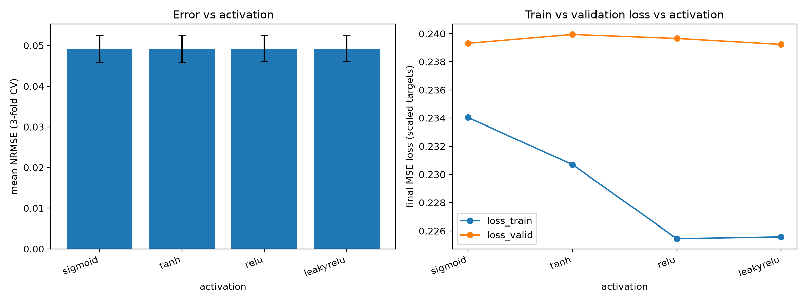
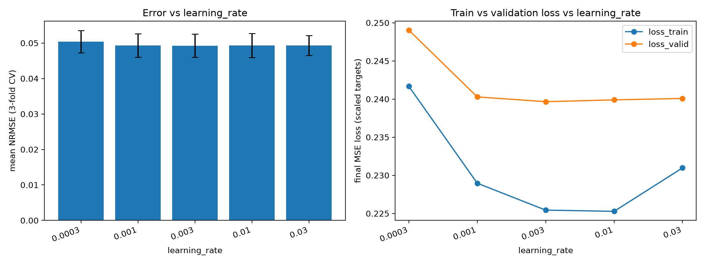
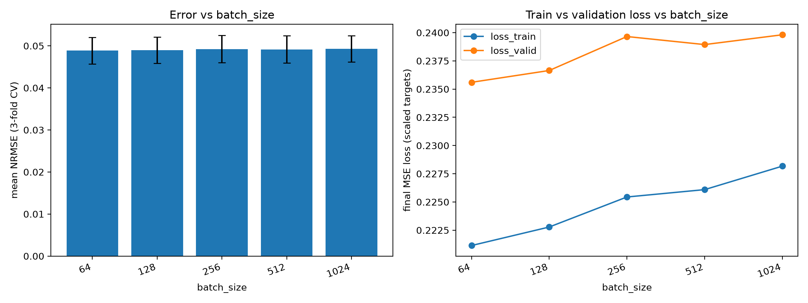

# Cell Culture Neural Network

This project trains a fully connected neural network, built in PyTorch, to predict three key outcomes of mammalian cell culture (specific growth rate, specific death rate and specific recombinant protein production rate) from seven process variables: temperature, pH, glucose, glutamine, lactate and ammonia concentrations, and viable cell density. Running `main.py` executes the whole workflow: a hyperparameter search, cross-validation of the best network, one-at-a-time sensitivity analyses and a polynomial regression baseline. It helps bioprocess engineers judge how well culture performance can be predicted from process conditions, and how much model complexity that actually requires.

## Highlights

- Designed a configurable PyTorch network (layers, activation, learning rate, batch size, weight decay) that predicts three bioprocess rates from seven inputs.
- Optimized hyperparameters with a 72-configuration search, selecting on final validation loss instead of the best epoch to avoid optimistic bias.
- Evaluated the optimal network with 4-fold cross-validation (mean NRMSE of about 0.05), fitting the scalers inside each fold to prevent data leakage.
- Analyzed sensitivity to each hyperparameter with five 3-fold sweeps, identifying underfitting from very narrow networks and strong weight decay.
- Benchmarked the network against degree-5 polynomial ridge regression, finding near-equal accuracy at a small fraction of the training time.

## Environment

- Python 3.12.16
- matplotlib 3.11.2
- numpy 2.5.4
- pandas 3.1.1
- scikit-learn 1.9.1
- torch 2.15.0

## Code Design

Running `main.py` executes four stages in order. Every stage writes its results to `tables/` (and, where relevant, `figures/`) and is skipped on later runs if its output file already exists. This keeps the workflow reproducible and lets figures be regenerated without retraining. All settings live in `src/constants.py`, the network is defined in `src/classes.py`, and all data handling, training and evaluation code lives in `src/functions.py`.

### Configuration (`src/constants.py`)

This file stores every fixed setting in one place: the dataset path, the three target column names, the random seed, the hyperparameter search grid, the optimal hyperparameters, the number of epochs, the number of cross-validation folds, the sweep values and the output paths. Centralizing these values means that changing an experiment (for example, adding a hyperparameter level) requires editing one file, and the rest of the code stays unchanged. It also documents exactly which settings produced the reported results.

### Data Loading and Splitting (`load_data`, `make_split`)

`load_data` reads the CSV with pandas and separates the seven input columns (temperature, pH, glucose, glutamine, lactate, ammonia and viable cell density) from the three target columns. `make_split` shuffles the row indices with a fixed seed and returns an 80/20 train and validation split. Splitting is needed because a model must be judged on rows it never trained on. The fixed seed makes the split identical on every run, so results are reproducible. This split is used for the hyperparameter search, where a single split keeps computation manageable.

### Scaling and Preprocessing (inside `train_model`)

The inputs span very different magnitudes: viable cell density is of the order of 10^6 cells/mL while pH is about 7. Without rescaling, large-valued inputs would dominate the gradients and training would be slow and unstable. Each input and each target is therefore standardized (mean 0, standard deviation 1). The means and standard deviations are computed from the training rows only and then applied to the validation rows. Doing this inside `train_model` means every cross-validation fold gets its own scaler, which prevents data leakage from the validation fold into training. Predictions are converted back to the original units before any error is reported, so the RMSE of each target is expressed in its own units.

### Network Definition (`src/classes.py`)

`FullyConnectedNN` is a PyTorch module that builds a fully connected network from a list of hidden layer widths and an activation name. For `hidden_layers=[32, 32]` and `activation="relu"` it creates 7 inputs, two hidden layers of 32 neurons with ReLU, and 3 outputs, one for each target. A dictionary maps the four supported activation names (`sigmoid`, `tanh`, `relu`, `leakyrelu`) to PyTorch classes. Making the architecture a function of its arguments is what allows the search and the sensitivity sweeps to train many different networks with one code path.

### Training and Evaluation (`train_model`)

`train_model` takes the training and validation data and the five hyperparameters (`hidden_layers`, `activation`, `learning_rate`, `batch_size`, `weight_decay`), scales the data, builds the network and trains it with the Adam optimizer on mean squared error. In each epoch it shuffles the training rows, runs mini-batch updates, and then records `loss_train` and `loss_valid` on the full training and validation sets. After the last epoch it predicts the validation set, converts the predictions back to original units, and computes RMSE and NRMSE for each target. NRMSE is the RMSE divided by the range (maximum minus minimum) of that target in the validation set. The range is used instead of the mean because the growth rate contains many values of exactly zero. The function returns the loss history and the metrics, which are the building blocks for every later stage. The random seed is set at the start of each call so that runs are reproducible.

### Hyperparameter Search (`run_search`)

`run_search` trains one network for every combination in the parameter grid (3 architectures, 2 activations, 2 learning rates, 2 batch sizes and 3 weight decays, giving 72 networks) using the single train/validation split. For each network it records the best validation loss, the epoch at which it occurred, the final validation loss and the mean NRMSE, and it rewrites `tables/search_results.csv` after every run so that progress is never lost. The optimal configuration is chosen from this table. This stage exists to find a good starting point cheaply before spending computation on cross-validation.

### Cross-Validation (`run_cv`, `summarize_cv`, `plot_cv_curves`)

`run_cv` evaluates the chosen network with k-fold cross-validation (4 folds). For each fold it trains a fresh network on the other folds, so every row is used for validation exactly once. `summarize_cv` reports the mean and standard deviation of RMSE and NRMSE across folds for each target, and `plot_cv_curves` draws the 2 x 2 figure of `loss_train` and `loss_valid` against epoch for the four folds. Cross-validation gives an estimate of performance that does not depend on one lucky split, and the figure confirms that training has converged within the chosen number of epochs.

### Sensitivity Sweeps (`run_sweeps`, `plot_sweeps`)

`run_sweeps` takes the optimal network as a baseline and varies one hyperparameter at a time (five values for architecture, learning rate, batch size and weight decay, and the four activation functions), keeping the others fixed. Each setting is evaluated with 3-fold cross-validation, reusing `run_cv`, and each sweep is saved to its own CSV. `plot_sweeps` then draws, for each hyperparameter, the mean NRMSE with error bars and the final training and validation loss. This stage isolates the effect of each hyperparameter, which is what supports the discussion of underfitting and overfitting in the analysis.

### Polynomial Regression Baseline (`poly_cv`, `run_poly`)

`poly_cv` fits a pipeline of standardization, polynomial feature expansion and ridge regression, and evaluates it on the same four folds and with the same RMSE and NRMSE definitions as the network. `run_poly` searches over polynomial degree (1 to 6) and ridge strength, records the time taken, and saves the best model's summary. A simple model with a fast, well-understood fit gives a reference point against which the neural network's accuracy and training cost can be judged fairly.

### Orchestration (`main.py`)

`main.py` loads the data, creates the `tables/` and `figures/` directories, and runs the stages in order: search, cross-validation, sweeps, polynomial baseline. Before each stage it checks whether the stage's result file exists and loads it if so. Deleting a result file forces that stage to be recomputed, and deleting all of them reproduces the complete analysis from scratch.

## Analysis

### Optimal Hyperparameters and Search Design

The search trained **72 networks** on a single 80/20 train/validation split (the three architectures, two activations, two learning rates, two batch sizes and three weight decays listed below, fully crossed). Results are in `tables/search_results.csv`. The optimal configuration is:

| Hyperparameter | Optimal value |
|---|---|
| `hidden_layers` | `[32, 32]` |
| `activation` | `"relu"` |
| `learning_rate` | 0.003 |
| `batch_size` | 256 |
| `weight_decay` | 0.0 |

**Epochs.** Every stage trains for 100 epochs. In a preliminary 200-epoch run of a mid-sized network, validation loss bottomed out around epochs 80 to 100 and then drifted upward while training loss kept falling, so training much longer only adds overfitting. The `best_epoch` column of the search agrees: for most configurations the validation minimum falls between epochs 55 and 100. The 2 x 2 figure in the next subsection shows the loss curves flattening by about epoch 50 in every fold, so 100 epochs is enough for training to complete.

**Search space.** Each level was chosen to cover the sensible range at a cost that fit a laptop budget (72 networks of 100 epochs each, on the order of tens of minutes in total):

- **`hidden_layers`: `[32, 32]`, `[64, 64]`, `[128, 128]` (3 levels).** Width is the main capacity knob, and these values span a four-fold range at a fixed depth. Depth was left to the sensitivity sweeps.
- **`activation`: `relu`, `tanh` (2 levels).** These are the two most common choices. The other two (`sigmoid`, `leakyrelu`) are compared in the activation sweep, so including them here would have added cost without new information.
- **`learning_rate`: 0.001, 0.003 (2 levels).** These are the usual range for Adam on standardized data. A wider range is covered by the learning-rate sweep.
- **`batch_size`: 64, 256 (2 levels).** These contrast many noisy updates per epoch with fewer, smoother ones.
- **`weight_decay`: 0.0, 1e-4, 1e-3 (3 levels).** I gave weight decay the extra level because an early 200-epoch run showed validation loss rising, which is a classic reason to regularize. Including 0.0 lets the search show whether regularization is needed at all.

The resulting grid is 3 x 2 x 2 x 2 x 3 = 72. The levels were split unevenly on purpose: hyperparameters with the strongest prior reason to matter (width and weight decay) got three levels, while those that are covered again in the sweeps got two.

**Why this configuration.** The search table is flat: the best validation loss across all 72 networks only spans about 0.2276 to 0.2402, so many configurations are nearly equivalent. Ranking by the *minimum* validation loss over epochs is optimistic, because it picks the luckiest epoch, while in practice one trains for a fixed number of epochs and keeps the final model. I therefore ranked by `final_loss_valid`. By that measure the top five are:

| Rank | Network | lr | Batch | Weight decay | Final valid loss |
|---|---|---|---|---|---|
| 1 | `[32, 32]` relu | 0.003 | 256 | 0.0 | 0.2309 |
| 2 | `[128, 128]` relu | 0.003 | 64 | 1e-4 | 0.2311 |
| 3 | `[64, 64]` relu | 0.001 | 64 | 1e-4 | 0.2317 |
| 4 | `[32, 32]` relu | 0.003 | 256 | 1e-4 | 0.2319 |
| 5 | `[64, 64]` relu | 0.003 | 256 | 1e-4 | 0.2320 |

I chose rank 1. Its final loss (0.2309) is close to its best-epoch loss (0.2291), so it is stable at the end of training, and it is the smallest and cheapest network. Honestly, its lead over rank 2 is 0.0002, which is within run-to-run noise, so simplicity was the deciding factor. Two patterns in the search are worth noting. First, large networks combined with `learning_rate = 0.003` and `batch_size = 64` reach their best epoch early (epochs 15 to 20) and then get worse (for example, the `[128, 128]` run with no weight decay has a best loss of 0.2308 but a final loss of 0.2510), which is overfitting driven by aggressive updates. Second, `weight_decay = 1e-3` is almost always the worst setting. I expected moderate weight decay to help, and the data says it does not.

### Four-Fold Cross-Validation of the Optimal Network

The optimal network was evaluated with 4-fold cross-validation (`tables/cv_summary.csv`, `tables/cv_fold_metrics.csv`). NRMSE is RMSE divided by the range of the target in the validation fold.

| Target | RMSE (mean ± SD) | NRMSE (mean ± SD) |
|---|---|---|
| Specific growth rate [d^-1] | 0.02642 ± 0.00024 | 0.0484 ± 0.0055 |
| Specific death rate [d^-1] | 0.003253 ± 0.000025 | 0.0545 ± 0.0022 |
| Specific production rate [pg cell^-1 d^-1] | 2.462 ± 0.015 | 0.0504 ± 0.0073 |

The figure shows that training is complete within the 100 epochs in all four folds: both curves fall steeply during the first 10 to 15 epochs, then flatten from roughly epoch 40 to 100 with no downward trend at the right edge. The gap between `loss_train` and `loss_valid` is small (about 0.01) and does not widen, so there is no sign of overfitting. The RMSE standard deviations are about 1% of the mean or less, so performance does not depend on which rows land in validation. The NRMSE standard deviations are larger because the range used for normalization changes with the extreme values in each fold, so range-normalized NRMSE is sensitive to outliers. NRMSE should only be compared within the same evaluation scheme.

### Influence of `hidden_layers`

| `hidden_layers` | Mean NRMSE | Final train loss | Final valid loss |
|---|---|---|---|
| `[8]` | 0.0598 | 0.348 | 0.351 |
| `[16, 16]` | 0.0495 | 0.236 | 0.242 |
| `[32, 32]` (optimal) | 0.0493 | 0.225 | 0.240 |
| `[32, 32, 32]` | 0.0493 | 0.224 | 0.239 |
| `[64, 64, 64]` | 0.0501 | 0.207 | 0.248 |

The single narrow layer of 8 neurons clearly **underfits**: its training and validation losses are both high and almost equal, so it lacks the capacity to represent the relationships. From `[16, 16]` upward the error is essentially flat. The largest network, `[64, 64, 64]`, has the lowest training loss but a higher validation loss, which is the beginning of **overfitting**. A moderate size is therefore enough, and extra capacity brings no benefit (`tables/sweep_hidden_layers.csv`).

### Influence of `activation`

| `activation` | Mean NRMSE | Final train loss | Final valid loss |
|---|---|---|---|
| `sigmoid` | 0.04924 | 0.234 | 0.239 |
| `tanh` | 0.04922 | 0.231 | 0.240 |
| `relu` (optimal) | 0.04925 | 0.225 | 0.240 |
| `leakyrelu` | 0.04922 | 0.226 | 0.239 |

All four activations give the same validation error to within 0.00003 in NRMSE, far smaller than any noise in the estimate, so the choice of activation has no measurable effect on accuracy here. The only visible difference is in training loss: ReLU and LeakyReLU fit the training data slightly better in 100 epochs than sigmoid, which is consistent with their faster optimization, but this does not carry over to validation (`tables/sweep_activation.csv`).

### Influence of `learning_rate`

| `learning_rate` | Mean NRMSE | Final train loss | Final valid loss |
|---|---|---|---|
| 0.0003 | 0.0504 | 0.242 | 0.249 |
| 0.001 | 0.0493 | 0.229 | 0.240 |
| 0.003 (optimal) | 0.0493 | 0.225 | 0.240 |
| 0.01 | 0.0493 | 0.225 | 0.240 |
| 0.03 | 0.0493 | 0.231 | 0.240 |

Only the smallest learning rate is clearly worse. Its training loss is also higher, so the network is **undertrained** after 100 epochs rather than overfit. From 0.001 to 0.03 the validation error is flat, which shows that the problem is forgiving to step size once it is large enough. The training loss rises again at 0.03, hinting that steps are getting too large, but validation is unaffected at this point (`tables/sweep_learning_rate.csv`).

### Influence of `batch_size`

| `batch_size` | Mean NRMSE | Final train loss | Final valid loss |
|---|---|---|---|
| 64 | 0.0489 | 0.221 | 0.236 |
| 128 | 0.0490 | 0.223 | 0.237 |
| 256 (optimal) | 0.0493 | 0.225 | 0.240 |
| 512 | 0.0492 | 0.226 | 0.239 |
| 1024 | 0.0493 | 0.228 | 0.240 |

Smaller batches are slightly better: batch size 64 has the lowest validation loss (0.236 against 0.240 at the optimum). This is expected, because for a fixed number of epochs a smaller batch means more weight updates. The effect is small, about 0.0004 in NRMSE, so I would not call it conclusive. It does disagree slightly with the search, which favoured 256 on a single split. I kept 256 because it makes about four times fewer updates per epoch than 64, so it trains faster for nearly the same error (`tables/sweep_batch_size.csv`).

### Influence of `weight_decay`

| `weight_decay` | Mean NRMSE | Final train loss | Final valid loss |
|---|---|---|---|
| 0.0 (optimal) | 0.04925 | 0.225 | 0.240 |
| 1e-5 | 0.04925 | 0.225 | 0.239 |
| 1e-4 | 0.04924 | 0.226 | 0.239 |
| 1e-3 | 0.0495 | 0.233 | 0.242 |
| 1e-2 | 0.0540 | 0.284 | 0.288 |

Because the optimum is 0.0, it was compared with four higher values. Values up to 1e-4 are indistinguishable from none. At 1e-3 the error rises slightly, and at 1e-2 it rises clearly, with training and validation losses both high and close together, which is **underfitting** from over-regularization. This is the opposite of what I expected from the early overfitting trend: the overfitting is mild, and regularization costs more than it saves (`tables/sweep_weight_decay.csv`).

**A note on interpreting the sweeps.** Across all five sweeps the NRMSE of most settings lies within about 0.0005 of the optimum, while the fold-to-fold standard deviation of NRMSE is about 0.003. All settings use the same folds, so comparisons between them are more reliable than that standard deviation implies, but the run uses one random seed. I therefore only claim effects for the three clearly different cases: the `[8]` network, the smallest learning rate, and `weight_decay = 1e-2`. Everything else is best described as indistinguishable. The 3-fold NRMSE of the optimum (0.0493) also differs from its 4-fold value (about 0.0511 averaged over targets) because the folds and normalization ranges differ, so the two schemes should not be compared with each other.

### Next Steps with More Computational Power

The sweeps show that hyperparameters matter little once the network is large enough and lightly regularized: nearly every reasonable setting lands near the same error (validation loss about 0.24). That suggests the model is limited by noise or missing information in the data rather than by tuning, so I would prioritize:

1. **Quantify the noise floor.** Repeat training with several random seeds and repeated cross-validation to estimate how much of the remaining error is run-to-run variation, and to test whether the small effects (such as batch size 64) are real.
2. **Search more efficiently.** Replace the grid with random or Bayesian search over wider ranges (learning rate between 1e-4 and 3e-2, batch size between 32 and 512), and add early stopping and a learning-rate schedule so the epoch count no longer needs to be fixed.
3. **Add the dimensions that did not help in isolation.** Combine moderate depth (3 layers) with small batch sizes and light regularization such as dropout, because the one-at-a-time sweeps cannot detect interactions between hyperparameters.
4. **Improve the inputs and targets.** Try a log transform of viable cell density, which spans two orders of magnitude, interaction features, and a separate model or specialized loss for the growth rate, which contains many exact zeros.
5. **Try other model families and ensembles.** Gradient-boosted trees and an ensemble of several networks would show whether the floor is a property of the data or of this model class.

### Comparison with Polynomial Regression

A polynomial ridge regression (standardization, polynomial features, ridge) was tuned over degree 1 to 6 and ridge strength 0.01 to 10 using the same four folds (`tables/poly_grid.csv`, `tables/poly_summary.csv`).

| Degree | 1 | 2 | 3 | 4 | 5 | 6 |
|---|---|---|---|---|---|---|
| Mean NRMSE | 0.0779 | 0.0639 | 0.0573 | 0.0532 | **0.0519** | 0.0526 |

Error falls with degree up to 5 and rises again at 6, so degree 5 is a genuine optimum inside the grid. The ridge strength had no measurable effect: all four values give identical NRMSE to four decimals, because with about 19,000 training rows per fold the model has far more data than coefficients, so regularization is unnecessary. The comparison with the tuned neural network is:

| Target | NN RMSE | Poly RMSE | NN NRMSE | Poly NRMSE |
|---|---|---|---|---|
| Specific growth rate | 0.02642 | 0.02650 | 0.0484 | 0.0485 |
| Specific death rate | 0.003253 | 0.003275 | 0.0545 | 0.0549 |
| Specific production rate | 2.462 | 2.554 | 0.0504 | 0.0524 |
| Mean over targets | | | 0.0511 | 0.0519 |

The two models are essentially tied on growth and death rates (differences under 1%, far below the fold-to-fold spread). The neural network is modestly better for the production rate, with about 3.5% lower RMSE, which is the only visible gap. Averaged over the three targets the network's NRMSE is 0.0511 against 0.0519 for the polynomial. This agrees with the sweeps: both model types hit the same error floor.

The difference in cost is far larger than the

