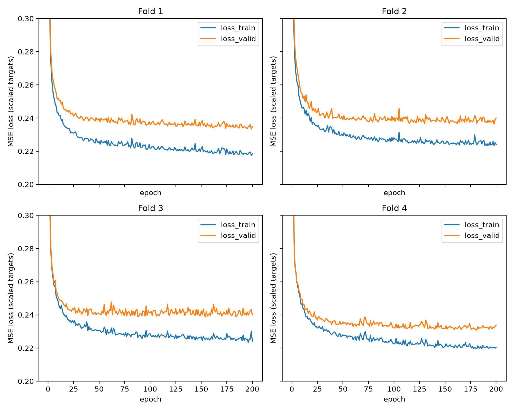
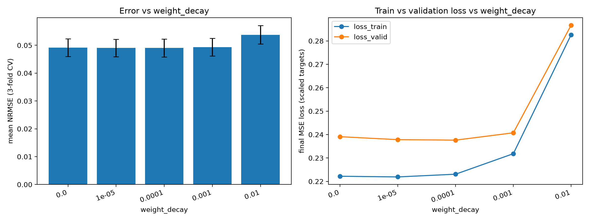

# Cell Culture Neural Network

This project trains a fully connected neural network, built in PyTorch, to predict three key outcomes of mammalian cell culture from seven process variables. The inputs are temperature, pH, glucose, glutamine, lactate and ammonia concentrations, and viable cell density. The outputs are the specific growth rate, the specific death rate and the specific recombinant protein production rate. Running `main.py` executes the complete workflow: a hyperparameter grid search, 4-fold cross-validation of the selected network, one-at-a-time sensitivity analyses of every hyperparameter, and a tuned polynomial regression baseline. Every stage saves its results as CSV tables and PNG figures, so the analysis can be reproduced and the figures regenerated without retraining. The project helps bioprocess engineers judge how accurately culture performance can be predicted from process conditions, and how much model complexity that prediction actually requires.

## Highlights

- Built a configurable PyTorch network whose depth, width, activation, learning rate, batch size and weight decay are set from a single configuration file.
- Optimized five hyperparameters with a 72-configuration grid search, ranking on final rather than best-epoch validation loss to avoid an optimistic bias.
- Validated the selected network with 4-fold cross-validation (mean NRMSE of 0.051), fitting the scalers inside each fold to prevent data leakage.
- Analyzed the effect of each hyperparameter with five 3-fold sensitivity sweeps, identifying underfitting, overfitting and the onset of mild overfitting at long training times.
- Benchmarked the network against a tuned degree-5 polynomial ridge regression, which reached near-equal accuracy with about 30 times less training time.

## Environment

- Python 3.12.16
- matplotlib 3.11.2
- numpy 2.5.4
- pandas 3.1.1
- scikit-learn 1.9.1
- torch 2.15.0

## Code Design

Running `main.py` executes four stages in order: hyperparameter search, cross-validation, sensitivity sweeps and the polynomial baseline. Every stage writes its results to `tables/` (and, where relevant, `figures/`) and is skipped on later runs if its output already exists. This makes the workflow reproducible, protects long computations from being repeated, and lets figures be regenerated in seconds. All settings live in `src/constants.py`, the network is defined in `src/classes.py`, and all data handling, training and evaluation code lives in `src/functions.py`.

### Configuration (`src/constants.py`)

This file stores every fixed setting in one place: the dataset path, the three target column names, the random seed, the hyperparameter search grid and its number of epochs, the selected optimal hyperparameters, the number of epochs for final training, the number of cross-validation folds, the sweep values, the polynomial degrees and ridge strengths, and every output path. Centralizing these values means that changing an experiment, such as adding a sweep value, requires editing one file while the rest of the code stays unchanged. It also documents exactly which settings produced the reported results.

### Data Loading and Splitting (`load_data`, `make_split`)

`load_data` reads `datasets/dataset_cell_growth_7factor.csv` (25,600 rows) with pandas and separates the seven input columns from the three target columns, returning NumPy arrays. `make_split` shuffles the row indices with a fixed seed and returns an 80/20 train and validation split. Splitting is necessary because a model must be judged on rows it never trained on, and the fixed seed makes the split identical on every run. This single split is used only for the hyperparameter search, where it keeps the cost of training 72 networks manageable.

### Scaling (inside `train_model`)

The inputs span very different magnitudes: viable cell density ranges from about 10^5 to 10^7 cells/mL, while pH lies between 6.6 and 7.6. Without rescaling, large-valued inputs would dominate the gradients and training would be slow and unstable. Each input and each target is therefore standardized to a mean of 0 and a standard deviation of 1. The means and standard deviations are computed from the training rows only and then applied to the validation rows. Because this happens inside `train_model`, every cross-validation fold gets its own scaling, which prevents information from the validation rows leaking into training. Predictions are converted back to original units before any error is reported, so each RMSE is expressed in the units of its target.

### Network Definition (`src/classes.py`)

`FullyConnectedNN` is a PyTorch module that builds a fully connected network from a list of hidden layer widths and an activation name. For `hidden_layers=[32, 32]` and `activation="relu"` it creates 7 inputs, two hidden layers of 32 neurons with ReLU, and 3 linear outputs, one per target, for a total of 1,411 trainable parameters. A dictionary maps the four supported activation names (`sigmoid`, `tanh`, `relu`, `leakyrelu`) to PyTorch classes. Building the architecture from arguments is what allows the search and the sweeps to train many different networks through one code path.

### Training and Evaluation (`train_model`)

`train_model` receives the training and validation data and the five hyperparameters (`hidden_layers`, `activation`, `learning_rate`, `batch_size`, `weight_decay`). It scales the data, builds the network and trains it with the Adam optimizer on mean squared error, with `weight_decay` passed to Adam as L2 regularization. In each epoch it shuffles the training rows, performs mini-batch updates, and then records `loss_train` and `loss_valid` on the full training and validation sets. After the last epoch it predicts the validation set, converts the predictions back to original units, and computes RMSE and NRMSE for each target. NRMSE is RMSE divided by the range (maximum minus minimum) of the target in the validation set. The range is used instead of the mean because about 16% of growth rates are exactly zero, which makes the mean a poor normalizer. The random seed is set at the start of every call so that results are reproducible. This function is the building block of every later stage.

### Stage 1: Hyperparameter Search (`run_search`)

`run_search` trains one network for every combination in the parameter grid (3 architectures x 2 activations x 2 learning rates x 2 batch sizes x 3 weight decays = 72 networks) for 100 epochs on the single train/validation split. For each network it records the lowest validation loss, the epoch at which it occurred, the final validation loss and the mean NRMSE. It rewrites `tables/search_results.csv` after every network so that progress is never lost. When `main.py` later finds this file, it checks that it contains all 72 rows and stops with an error if it does not, so a search interrupted halfway can never be mistaken for a finished one. The optimal configuration, stored in `src/constants.py`, is selected from this table. This stage finds a good configuration cheaply before more expensive cross-validation is spent on it.

### Stage 2: Cross-Validation (`run_cv`, `summarize_cv`, `plot_cv_curves`)

`run_cv` evaluates the optimal network with 4-fold cross-validation for 200 epochs. For each fold it trains a fresh network on the other three folds, so every row is used for validation exactly once. `summarize_cv` reports the mean and standard deviation of RMSE and NRMSE across folds for each target. `plot_cv_curves` draws the 2 x 2 figure of `loss_train` and `loss_valid` against epoch, one subplot per fold, with the y-axis limited to 0.20 to 0.30 so that the end of training, where convergence is judged, is clearly visible. `main.py` also times this stage and saves the result to `tables/nn_timing.csv`, which provides the evidence for the training-time comparison with polynomial regression. Cross-validation gives a performance estimate that does not depend on one particular split.

### Stage 3: Sensitivity Sweeps (`run_sweeps`, `plot_sweeps`)

`run_sweeps` uses the optimal network as a baseline and changes one hyperparameter at a time while holding the others at their optimal values: five architectures, four activations, and five values each of learning rate, batch size and weight decay. Each setting is evaluated with 3-fold cross-validation for 200 epochs by reusing `run_cv`, and each sweep is saved to its own CSV. `plot_sweeps` then draws, for each hyperparameter, the mean NRMSE with error bars (standard deviation across folds) next to the final training and validation losses. Showing both losses side by side is what allows each change in error to be diagnosed as underfitting or overfitting.

### Stage 4: Polynomial Regression Baseline (`poly_cv`, `run_poly`)

`poly_cv` fits a scikit-learn pipeline of standardization, polynomial feature expansion and ridge regression, and evaluates it on the same four folds (same seed) with the same RMSE and NRMSE definitions as the network, so the comparison is like for like. `run_poly` searches polynomial degrees 1 to 6 and ridge strengths 0.01 to 100, records the training time of each combination, and saves the full grid and the best model's summary. This provides a fast, well-understood reference against which the accuracy and cost of the neural network can be judged.

### Orchestration (`main.py`)

`main.py` loads the data, creates the output directories and runs the four stages in order, printing each stage's key results. Before each stage it checks whether that stage's output files exist and loads them if so. Deleting a stage's files forces it to be recomputed, and deleting all of them reproduces the complete analysis from scratch.

## Analysis

### Optimal Hyperparameters

The search trained **72 networks** for 100 epochs on a single 80/20 train/validation split (`tables/search_results.csv`). A single split was used instead of cross-validation to keep the search affordable. The selected configuration is:

| Hyperparameter | Optimal value |
|---|---|
| `hidden_layers` | `[32, 32]` |
| `activation` | `"relu"` |
| `learning_rate` | 0.003 |
| `batch_size` | 256 |
| `weight_decay` | 0.0 |

**Search space.** Each set of values was chosen to cover a sensible range within a laptop budget:

- **`hidden_layers`: `[32, 32]`, `[64, 64]`, `[128, 128]` (3 values).** Width is the main capacity setting, and these values span a four-fold range at a fixed depth of two layers, which is enough for a smooth seven-input problem. The effect of depth was left to the sensitivity sweep.
- **`activation`: `relu`, `tanh` (2 values).** These are the two most widely used activations for regression networks. `sigmoid` and `leakyrelu` are compared in the activation sweep.
- **`learning_rate`: 0.001, 0.003 (2 values).** This is the standard range for Adam on standardized data. A much wider range, from 0.0003 to 0.03, is tested in the learning rate sweep.
- **`batch_size`: 64, 256 (2 values).** These contrast many small, noisy updates per epoch with fewer, smoother ones.
- **`weight_decay`: 0.0, 1e-4, 1e-3 (3 values).** Including 0.0 tests whether regularization is needed at all, and the two non-zero values cover light and moderate regularization.

The grid is 3 x 2 x 2 x 2 x 3 = **72 configurations**. The values are distributed unevenly on purpose: width and weight decay received three values because they control the balance between underfitting and overfitting and had the strongest prior reason to matter, while activation, learning rate and batch size received two because each is explored over a much wider range in its own sweep.

**Epochs.** The search used 100 epochs, which is enough to rank configurations: the `best_epoch` column shows a median best epoch of 82, and three quarters of the networks reach their validation minimum after epoch 67. For the final network we first ran the 4-fold cross-validation at 100 epochs, but validation loss was still falling slightly at the last epoch in two folds (in fold 4 the minimum was at epoch 100 itself). Training could therefore not be shown to be complete, so we increased the final training to **200 epochs**. The 2 x 2 figure in the next subsection shows that validation loss is flat well before epoch 200 in every fold. Doubling the epochs did not change the cross-validated error (mean NRMSE 0.0511 at 100 epochs and 0.0510 at 200 epochs), which confirms that the 100-epoch result was already close to convergence and that 200 epochs is sufficient.

**Choice of the optimal set.** The search results are very flat: the lowest validation loss of the 72 networks only ranges from 0.2276 to 0.2402, so many configurations are nearly equivalent. Ranking by the *lowest* validation loss over all epochs is optimistic, because it picks the luckiest epoch, while in practice a network is trained for a fixed number of epochs and the final model is kept. We therefore ranked by `final_loss_valid`. The top five are:

| Rank | Network | Learning rate | Batch size | Weight decay | Final valid loss |
|---|---|---|---|---|---|
| 1 | `[32, 32]` relu | 0.003 | 256 | 0.0 | 0.2309 |
| 2 | `[128, 128]` relu | 0.003 | 64 | 1e-4 | 0.2311 |
| 3 | `[64, 64]` relu | 0.001 | 64 | 1e-4 | 0.2317 |
| 4 | `[32, 32]` relu | 0.003 | 256 | 1e-4 | 0.2319 |
| 5 | `[64, 64]` relu | 0.003 | 256 | 1e-4 | 0.2320 |

We selected rank 1. Its lead over rank 2 (0.0002) is within run-to-run noise, so the deciding factors were stability and simplicity: its final loss (0.2309) is close to its best-epoch loss (0.2291), so it does not degrade late in training, and it is the smallest network in the top five, with about 1,400 parameters compared with about 17,900 for `[128, 128]`. Two further patterns support this choice. First, the largest networks combined with a learning rate of 0.003 and a batch size of 64 overfit early: the unregularized `[128, 128]` relu network reached its best validation loss (0.2308) at epoch 15 and finished at 0.2510. Second, `weight_decay = 1e-3` gave the worst final validation loss in 15 of the 24 groups of otherwise identical configurations, so moderate regularization did not help at 100 epochs.

### Four-Fold Cross-Validation of the Optimal Network

The optimal network was evaluated with 4-fold cross-validation for 200 epochs (`tables/cv_summary.csv`, `tables/cv_fold_metrics.csv`). NRMSE is RMSE divided by the range of the target in the validation fold.

| Target | RMSE (mean ± SD) | NRMSE (mean ± SD) |
|---|---|---|
| Specific growth rate [d^-1] | 0.02638 ± 0.00020 | 0.0483 ± 0.0054 |
| Specific death rate [d^-1] | 0.003229 ± 0.000010 | 0.0541 ± 0.0024 |
| Specific production rate [pg cell^-1 d^-1] | 2.469 ± 0.013 | 0.0506 ± 0.0074 |

Averaged over the three targets, the mean NRMSE is **0.0510**, meaning the typical prediction error is about 5% of each target's range. The death rate is the hardest target to predict and the growth rate the easiest.

The figure confirms that training is complete within 200 epochs in all four folds. Both losses fall steeply over the first 10 to 20 epochs. Validation loss levels off at about 0.233 to 0.240 by epoch 75 to 100 and stays flat to epoch 200, with only a small downward drift of about 0.002 in folds 1 and 4, which is smaller than the epoch-to-epoch noise. Training loss keeps decreasing slowly, so the gap between the curves widens slightly to about 0.015 to 0.02 by epoch 200. This indicates mild overfitting, which the sensitivity sweeps below confirm. The y-axis is limited to 0.20 to 0.30 to make the end of training visible; the first epochs start near 0.42 and are cut off.

The RMSE standard deviations are below 1% of the mean for every target, so performance does not depend on which rows land in the validation fold. The NRMSE standard deviations are relatively larger because the range used for normalization depends on the most extreme values in each fold. Range-normalized NRMSE is therefore sensitive to outliers and should only be compared within the same evaluation scheme.

### Sensitivity Analysis

Each sweep changes one hyperparameter while holding the others at their optimal values, and evaluates each setting with 3-fold cross-validation for 200 epochs. Each table reports the mean NRMSE over folds and targets and the final training and validation losses (on scaled targets). Comparing the two losses diagnoses each result: if both are high and close together, the model is underfitting; if training loss is low but validation loss is high, it is overfitting.

#### Influence of `hidden_layers`

| `hidden_layers` | Mean NRMSE | Final train loss | Final valid loss |
|---|---|---|---|
| `[8]` | 0.0592 | 0.339 | 0.342 |
| `[16, 16]` | 0.0492 | 0.234 | 0.240 |
| `[32, 32]` (optimal) | 0.0492 | 0.222 | 0.239 |
| `[32, 32, 32]` | 0.0492 | 0.219 | 0.239 |
| `[64, 64, 64]` | 0.0513 | 0.190 | 0.263 |

Architecture produces the clearest effects of any hyperparameter, at both ends. The single layer of 8 neurons **underfits**: its training and validation losses are both high and nearly equal, so it lacks the capacity to represent the input-output relationships. The largest network, `[64, 64, 64]`, **overfits**: it has by far the lowest training loss (0.190) but the highest validation loss among the deeper networks (0.263), a gap of 0.073 compared with 0.017 at the optimum. Between these extremes, `[16, 16]`, `[32, 32]` and `[32, 32, 32]` give identical validation error, so a moderate network captures everything the data can support and extra capacity only adds the risk of overfitting (`tables/sweep_hidden_layers.csv`).

#### Influence of `activation`

| `activation` | Mean NRMSE | Final train loss | Final valid loss |
|---|---|---|---|
| `sigmoid` | 0.0487 | 0.228 | 0.234 |
| `tanh` | 0.0491 | 0.226 | 0.238 |
| `relu` (optimal) | 0.0492 | 0.222 | 0.239 |
| `leakyrelu` | 0.0491 | 0.223 | 0.239 |

All four activations give similar errors, but `sigmoid` is slightly better (validation loss 0.234 against 0.239 for `relu`). The training losses explain why: ReLU and LeakyReLU fit the training data most closely, and their train-validation gap (about 0.017) is three times that of sigmoid (about 0.006). The smoother, saturating sigmoid limits how closely the network can follow noise in the training data, which acts as mild regularization at 200 epochs. The improvement (0.0005 in NRMSE) is small compared with the fold-to-fold standard deviation of about 0.003, but every setting uses the same folds, so the consistent direction across all three targets suggests it is real. Sigmoid was not part of the search grid, which is why it was not selected (`tables/sweep_activation.csv`).

#### Influence of `learning_rate`

| `learning_rate` | Mean NRMSE | Final train loss | Final valid loss |
|---|---|---|---|
| 0.0003 | 0.0495 | 0.232 | 0.242 |
| 0.001 | 0.0491 | 0.225 | 0.238 |
| 0.003 (optimal) | 0.0492 | 0.222 | 0.239 |
| 0.01 | 0.0492 | 0.222 | 0.240 |
| 0.03 | 0.0494 | 0.233 | 0.241 |

The learning rate shows a shallow U-shape. At 0.0003 the training loss is higher than at the optimum, so the network is still **undertrained** after 200 epochs because its steps are too small. At 0.03 the training loss rises again, because the steps are too large for the optimizer to settle into a minimum. Between 0.001 and 0.01 the validation error is flat, so the problem tolerates a ten-fold range of learning rates. The value 0.001 is marginally better than the optimum, but the difference (0.0001 in NRMSE) is negligible (`tables/sweep_learning_rate.csv`).

#### Influence of `batch_size`

| `batch_size` | Mean NRMSE | Final train loss | Final valid loss |
|---|---|---|---|
| 64 | 0.0490 | 0.220 | 0.237 |
| 128 | 0.0490 | 0.220 | 0.237 |
| 256 (optimal) | 0.0492 | 0.222 | 0.239 |
| 512 | 0.0490 | 0.223 | 0.237 |
| 1024 | 0.0490 | 0.224 | 0.238 |

Batch size has no meaningful effect on error. Smaller batches give slightly lower training loss, as expected from the larger number of weight updates per epoch, but validation error shows no trend: all five values lie within 0.0002 in NRMSE. The optimum of 256 happens to give the highest value in this sweep, which disagrees with the search; given the size of the differences, this is noise rather than evidence that 256 is a poor choice. Because the error is insensitive to batch size, the practical choice is the one that trains fastest, and larger batches take fewer, cheaper steps per epoch (`tables/sweep_batch_size.csv`).

#### Influence of `weight_decay`

| `weight_decay` | Mean NRMSE | Final train loss | Final valid loss |
|---|---|---|---|
| 0.0 (optimal) | 0.0492 | 0.222 | 0.239 |
| 1e-5 | 0.0490 | 0.222 | 0.238 |
| 1e-4 | 0.0490 | 0.223 | 0.238 |
| 1e-3 | 0.0494 | 0.232 | 0.241 |
| 1e-2 | 0.0538 | 0.283 | 0.287 |

Because the optimum is 0.0, it was compared with four higher values. Light weight decay (1e-5 and 1e-4) slightly **improves** validation loss, from 0.239 to 0.238, which is consistent with the mild overfitting seen at 200 epochs: a small penalty on large weights narrows the train-validation gap at almost no cost to the training fit. This differs from the 100-epoch search, where weight decay did not help, because the overfitting only develops with longer training. At 1e-3 the training loss rises and the error worsens, and at 1e-2 both losses are high and close together, which is clear **underfitting** from over-regularization (`tables/sweep_weight_decay.csv`).

#### Summary of the Sweeps

Across the five sweeps, most settings lie within about 0.0005 in NRMSE of the optimum, while the fold-to-fold standard deviation is about 0.003. Since every setting uses the same folds, comparisons between settings are more reliable than that standard deviation suggests, but each result comes from a single random seed. We therefore only claim clear effects for the underfitting `[8]` network, the overfitting `[64, 64, 64]` network, the extreme learning rates (0.0003 and 0.03), and the over-regularized `weight_decay = 1e-2`. The smaller improvements from sigmoid, light weight decay and a learning rate of 0.001 all point in the same direction: at 200 epochs the optimal network overfits mildly, and settings that restrain it help slightly. The 3-fold NRMSE of the optimum (0.0492) differs from its 4-fold value (0.0510) because the folds and normalization ranges differ, so values from the two schemes should not be compared directly.

### Next Steps with More Computing Power

The sweeps show that, once the network is large enough and not over-regularized, nearly every reasonable setting reaches the same validation loss of about 0.24. This suggests that the model is limited mainly by noise or missing information in the data rather than by its hyperparameters. With more computing power we would:

1. **Quantify the noise floor.** Repeat cross-validation with several random seeds and repeated fold assignments to measure run-to-run variation, and test whether the small effects (sigmoid, light weight decay, a learning rate of 0.001) are statistically real.
2. **Search the promising settings together.** One-at-a-time sweeps cannot detect interactions, so we would run a combined search over sigmoid and tanh, weight decay between 1e-5 and 1e-4, learning rates between 0.001 and 0.003, and widths between 16 and 32, using random or Bayesian search with cross-validation instead of a single split.
3. **Add early stopping and a learning rate schedule.** The loss curves flatten by about epoch 100, so early stopping would choose the training length automatically, roughly halve the training time, and limit the mild overfitting seen at 200 epochs.
4. **Improve the inputs and targets.** Try a log transform of viable cell density, which spans two orders of magnitude, add interaction features, and treat the growth rate's many exact zeros with a separate model or a dedicated loss.
5. **Compare other model families.** Gradient-boosted trees and ensembles of several networks would show whether the error floor is a property of the data or of this model class.

### Comparison with Polynomial Regression

A polynomial ridge regression (standardization, polynomial features and ridge regression) was tuned over degrees 1 to 6 and ridge strengths of 0.01, 0.1, 1, 10 and 100, using the same four folds as the network (`tables/poly_grid.csv`, `tables/poly_summary.csv`). The best mean NRMSE for each degree is:

| Degree | 1 | 2 | 3 | 4 | 5 | 6 |
|---|---|---|---|---|---|---|
| Mean NRMSE | 0.0779 | 0.0639 | 0.0573 | 0.0532 | **0.0519** | 0.0526 |

The error falls with degree up to 5 and rises at 6, so degree 5 is a genuine optimum inside the grid: lower degrees underfit, and degree 6 starts to overfit. The ridge strength had almost no effect: values from 0.01 to 10 give identical error to four decimals, and only 100 is slightly worse (0.0520), so the selected value of 10 also lies inside the grid. Regularization matters little because each fold provides about 19,200 training rows for 791 polynomial terms per target.

| Target | NN RMSE | Poly RMSE | NN NRMSE | Poly NRMSE |
|---|---|---|---|---|
| Specific growth rate [d^-1] | 0.02638 | 0.02650 | 0.0483 | 0.0485 |
| Specific death rate [d^-1] | 0.003229 | 0.003275 | 0.0541 | 0.0549 |
| Specific production rate [pg cell^-1 d^-1] | 2.469 | 2.554 | 0.0506 | 0.0524 |
| Mean over targets | | | 0.0510 | 0.0519 |
| Training time, 4 folds | 22 s | 0.74 s | | |

**Performance.** The two models are essentially tied on the growth and death rates, with RMSE differences of 0.5% and 1.4%. The neural network is modestly better for the production rate, with about 3.3% lower RMSE, which is the only visible gap. Averaged over the targets, the network's NRMSE is 0.0510 against 0.0519 for the polynomial. Two very different model families converging on nearly the same error supports the conclusion from the sweeps that the remaining error is set by the data rather than by the model.

**Training time.** The difference in cost is far larger than the difference in accuracy. Over the same four folds, the polynomial trained in under a second (0.74 s, `tables/poly_summary.csv`), while the network took tens of seconds (22 s at 200 epochs, `tables/nn_timing.csv`), about 30 times longer. The gap grows further once tuning is included: the full polynomial grid of 30 models finishes in seconds, while the network's search and sweeps (144 networks) take minutes. The polynomial is also deterministic and has a closed-form solution, so it needs no choice of epochs, learning rate or batch size.

**Conclusion.** For this dataset, the tuned polynomial regression is the more practical model: it is about 30 times faster to train, simpler to tune, and only 2% less accurate on average. The neural network's small advantage on the production rate would only justify its cost in a setting where that target matters most, or if more data or more informative inputs lowered the error floor that both models currently reach.